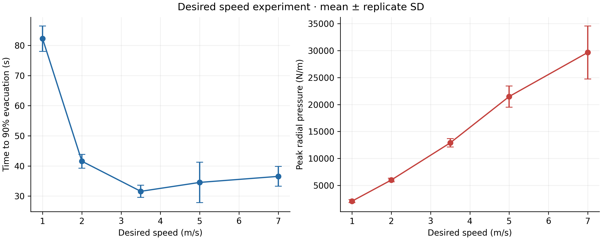
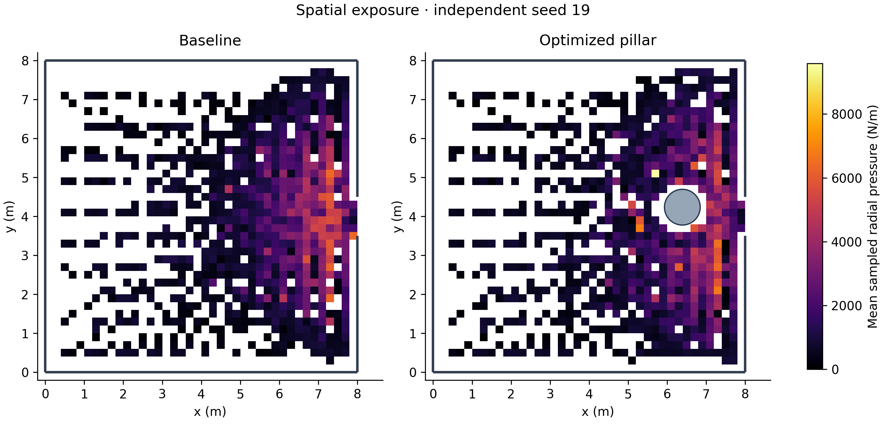
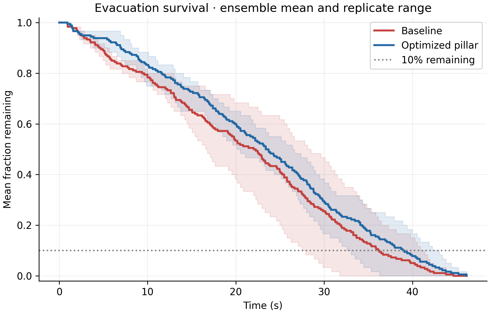
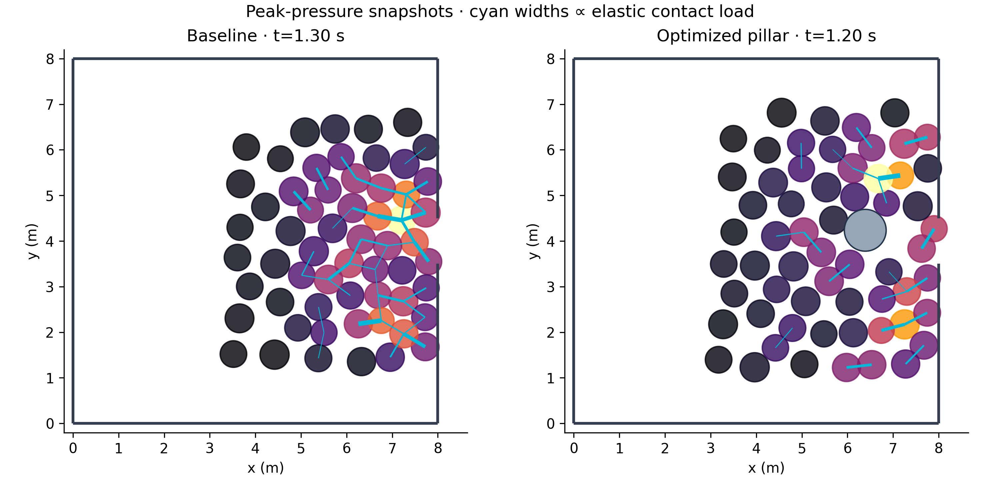

# Mitigating the Faster-is-Slower Effect and Crushing Pressures in Bottleneck Evacuations via Evolutionary Obstacle Optimization

**CrowdSafe-Physics contributors · Reproducible computational research manuscript · 26 October 2026**

This manuscript reports the archived numerical experiment. It is not peer reviewed, clinically validated, or a building-design certification. “Crushing pressure” below denotes a two-dimensional normal-force-per-circumference proxy, not measured tissue stress.

## Abstract

**Background.** Dense evacuation can exhibit competition between greater driving speed and dissipative contact congestion. Obstacles upstream of a narrow exit may alter contact networks, but their benefits depend on geometry and behavior.

**Methods.** We implemented the Helbing–Farkas–Vicsek social force law with vectorized pair interactions, exact segment/circle boundary distances, and local pillar steering. We simulated 60 soft disks in a 8 × 8 m room with a 1 m exit at five prescribed desired speeds. Differential evolution selected a single asymmetric circular obstacle using training seeds 7, 11; evaluation seeds 19, 23, 31 were excluded from selection. We measured T90, flow, pair and boundary-inclusive normal loading, operational contact arches, censoring, and timestep sensitivity.

**Results.** Mean T90 was smallest at 3.5 m/s and increased by 15.72% at 7 m/s. Mean peak pair pressure increased 2.30-fold across the same comparison. At 5 m/s the selected pillar produced a 25.43% reduction in mean replicate peak pressure and a 2.59% reduction in agent-time mean pressure, with a -8.07% change in mean flow. The >25% peak-reduction target was achieved; the faster-outflow target was not achieved on the independent evaluation ensemble.

**Conclusions.** The results quantify a finite-model speed/contact tradeoff and the measured effect of one optimized obstacle. Small ensembles, a soft-disk constitutive law, local navigation, and contact sensitivity limit extrapolation. No injury-prevention guarantee follows from these simulations.

## 1. Introduction

Crowd evacuation combines purposeful movement with constraints from bodies, walls, and bottlenecks. At low density, raising desired speed usually reduces free travel time. At higher density, additional driving can increase normal compression and tangential friction, potentially slowing passage. Helbing, Farkas and Vicsek [1] demonstrated that a social force formulation with granular contact terms can reproduce qualitative features associated with escape panic.

A strategically located obstacle can redistribute approaching flow before the doorway. Its effect is not universally favorable: it can also narrow usable routes, attract contact loading, or lengthen travel paths. Architecture should therefore be treated as an experimentally testable design variable rather than an assumed remedy.

This study asks two questions. First, does a fixed seeded HFV implementation show an evacuation-time minimum followed by high-speed slowdown? Second, can a small evolutionary search improve pressure and outflow on initial conditions excluded from optimization? The repository couples an educational derivation to executable tests and an auditable record of candidate evaluations. The phrase “mitigating” in the title identifies the research aim; numerical outcomes below determine which targets were actually met.

## 2. Methods

### 2.1 Dynamics and constitutive assumptions

For each pedestrian i, Newton's equation combines driving, pedestrian-pedestrian, and stationary boundary forces:

$$m_i\dot{\mathbf v}_i=\frac{m_i(v_i^0\mathbf e_i^0-\mathbf v_i)}{\tau}+\sum_{j\ne i}\mathbf f_{ij}+\sum_W\mathbf f_{iW}.$$

With h=max(r_i+r_j-d_ij,0), each pair interaction has a normal component A exp((r_i+r_j-d_ij)/B)+kh and a tangential component kappa h ((v_j-v_i)·t_ij). Tangential velocity differences use the sign that dissipates relative sliding energy. There is no rotational degree of freedom and no Coulomb static-friction law. Boundary forces use the analogous normal law and friction against stationary walls or pillars.

Constants are m=80 kg, tau=0.5 s, A=2000 N, B=0.08 m, k=120000 N/m, and kappa=240000 kg/(m s), following the HFV parameterization [1]. Radii are independent uniform samples over [0.28,0.32] m. The desired direction points toward a location 1 m beyond the exit, with smooth local transverse steering near pillars. This explicit navigation extension is documented in the tutorial and is not presented as an exact behavioral replication of the original study.

### 2.2 Geometry and initial conditions

The room is 8 m wide and 8 m high; its single centered right-wall exit is 1 m wide. Exact clipped point-to-segment projections handle both walls and jamb endpoints. Circle distance is center distance minus obstacle radius.

The 60 initial bodies occupy a separated, jittered upstream lattice. A fixed seed reproduces both positions and radii. The downstream design region is kept clear initially, and feasible candidates share the identical baseline state for each seed. Initial disk intersections are rejected. No stochastic forcing is applied after initialization.

### 2.3 Integration and event definition

The archived benchmark uses semi-implicit Euler with dt=0.0015 s and an observation horizon of 90 s. A 12 m/s velocity safeguard counts every activation. The code also supplies generalized velocity Verlet with three endpoint corrector iterations for velocity-dependent force; it is independently tested but is not the integrator used for these tables.

A complete-body exit occurs when the rear edge clears the wall plane, x_center=W+r_i, and the interpolated center lies in the aperture. Linear interpolation estimates the event time within the step; the body is then removed. T90 is the ceil(0.9 N)-th exit. Completion time is null if any body remains at the horizon. Restricted mean evacuation time includes unexited bodies at the observation endpoint, without fabricating events.

### 2.4 Pressure, flow, and arch candidates

Primary radial pressure is P_i=sum_j |f_ij^normal|/(2 pi r_i), in N/m. Normal magnitude includes social and elastic pair terms and excludes tangential force. A separate boundary-inclusive metric adds wall and pillar magnitudes. Mean pressure is weighted by active agent-time; maxima are sampled at every physics step. The requested 1,600 N/m threshold defines an exposure indicator in agent-seconds and is not a medically validated threshold in this implementation.

Whole-run flow equals observed exits divided by observation duration. The dashboard additionally uses a two-second rolling event rate. Contact-graph edges require elastic load ≥100 N. A component is an arch candidate when it connects both jamb neighborhoods, lies near the opening, and has mean speed below 0.35 m/s. The state is sampled every 0.15 s; duration uses left-interval accumulation. This operational detector does not solve equilibrium or establish mechanical self-locking.

### 2.5 Experimental design and optimization

The desired-speed experiment uses 1, 2, 3.5, 5, and 7 m/s on the same evaluation seeds 19, 23, 31. Table values are arithmetic means and sample standard deviations. Event means use only observed events and the JSON reports their observed counts. Total-evacuation censoring counts are listed explicitly. No inferential p-values are calculated from this small ensemble.

Differential evolution [2] optimizes z=(x,y,R) at 5 m/s on training seeds 7, 11. The objective averages 0.50 times baseline-normalized peak pressure, 0.25 times baseline-normalized mean pressure, and 0.25 times baseline-normalized restricted mean evacuation time, plus twice the fraction remaining. Pairing uses the identical seed-specific baseline denominator. The objective therefore encodes explicit pressure/efficiency preferences rather than maximizing a retrospectively chosen percentage improvement.

The bounds are x in [W−2.7,W−0.8] m, y in [H/2−1.1,H/2+1.1] m, and R in [0.18,0.65] m. Feasibility requires containment, initial-state clearance, jamb clearance, and |y−H/2|≥0.12 m. The search used seed 2026, population multiplier 4, and 3 generations, evaluating 48 distinct candidates (36 feasible). Local polishing was disabled and evaluation used deterministic single-worker updates. The fixed budget terminated with SciPy message: “Maximum number of iterations has been exceeded.”. This indicates a budgeted search, not a proof of global optimality.

Independent comparison used all evaluation seeds after design selection. Percentage changes below are ratios of ensemble means; a separate table preserves paired seed percentages. Baseline and selected pillar were additionally rerun at dt/2 on evaluation seed 19. This is a limited sensitivity analysis, not a full ensemble convergence study.

## 3. Results

### 3.1 Desired speed and high-speed slowdown

| Desired speed (m/s) | T90 (s) | Peak pressure (N/m) | Flow (ped/s) | Arch time (s) | Censored runs |
|---|---:|---:|---:|---:|---:|
| 1 | 82.23 ± 4.23 | 2097 ± 289 | 0.63 ± 0.03 | 0.00 ± 0.00 | 3 |
| 2 | 41.57 ± 2.29 | 6015 ± 323 | 1.18 ± 0.07 | 0.00 ± 0.00 | 0 |
| 3.5 | 31.57 ± 2.01 | 12897 ± 787 | 1.57 ± 0.06 | 0.75 ± 0.75 | 0 |
| 5 | 34.54 ± 6.73 | 21478 ± 1966 | 1.58 ± 0.28 | 4.05 ± 2.24 | 0 |
| 7 | 36.54 ± 3.29 | 29641 ± 4918 | 1.52 ± 0.12 | 7.60 ± 2.48 | 0 |

**Table 1.** Mean ± sample SD across 3 initial states. “Censored” refers to total evacuation at the observation horizon, not necessarily to T90.

The minimum measured mean T90 occurred at 3.5 m/s. Raising desired speed to 7 m/s increased T90 by 15.72% and mean replicate peak pressure by a factor of 2.30. This supports faster-is-slower over the observed high-speed branch. It does not imply that 7 m/s is slower than every lower speed: initial travel and contact delay compete.

**Figure 1.** Desired speed versus T90 and every-step peak pair-normal pressure. Error bars are sample SD, not confidence intervals. Seeds are paired across speeds.

### 3.2 Selected pillar and independent evaluation

The selected obstacle is centered at (6.390637,4.235755) m with radius 0.458513 m. Its lateral offset from the exit center is +0.235755 m. Training loss was 0.823839, compared with 1.000000 for baseline and 0.859797 for the best initial-population candidate. Evolutionary retention is independently unit tested; improvement in the training objective does not itself establish independent improvement.

| Outcome | Baseline | Selected pillar |
|---|---:|---:|
| T90 (s) | 34.54 ± 6.73 | 37.85 ± 4.90 |
| Total evacuation time (s) | 38.70 ± 6.50 | 41.68 ± 5.00 |
| Restricted mean evacuation time (s) | 20.95 ± 4.58 | 23.05 ± 3.00 |
| Peak pair pressure (N/m) | 21478 ± 1966 | 16017 ± 1301 |
| Agent-time mean pair pressure (N/m) | 2270 ± 61 | 2212 ± 43 |
| Peak boundary-inclusive pressure (N/m) | 24737 ± 2338 | 17038 ± 2121 |
| Mean flow (ped/s) | 1.582 ± 0.279 | 1.454 ± 0.181 |
| Threshold exposure (agent-s) | 718.71 ± 185.40 | 787.67 ± 115.99 |
| Arch-candidate duration (s) | 4.05 ± 2.24 | 4.00 ± 2.93 |
| Maximum pair overlap (m) | 0.1020 ± 0.0097 | 0.1082 ± 0.0153 |
| Capped body updates | 0 ± 0 | 0 ± 0 |

**Table 2.** Baseline versus selected pillar at 5 m/s on independent seeds. There were 0 baseline censored runs and 0 pillar censored runs. Boundary-inclusive pressure and overlap expose possible redistribution of load and numerical/constitutive sensitivity.

Relative to ensemble baseline means, peak pair pressure reduction was 25.43%, agent-time mean pair pressure reduction was 2.59%, and flow changed by -8.07%. A negative pressure reduction denotes worse loading. The requested >25% peak-reduction outcome was **achieved**, and increased mean outflow was **not achieved**.

| Evaluation seed | Peak-pressure reduction (%) | Mean-pressure reduction (%) | Flow change (%) |
|---|---:|---:|---:|
| 19 | 20.72 | 7.48 | +23.05 |
| 23 | 35.47 | -1.13 | -25.43 |
| 31 | 18.77 | 1.17 | -14.02 |

**Table 3.** Paired seed effects. Positive pressure reductions mean lower load; positive flow changes mean faster outflow. Individual effects can differ from ratios of ensemble means.

**Figure 2.** Mean sampled pressure by spatial bin for independent seed 19, with a common color scale and masked unvisited cells. This conditional spatial mean differs from the every-step agent-time mean in Table 2.

**Figure 3.** Ensemble mean of event-based fractions remaining over all independent evaluation seeds. Shaded bands show the replicate minimum–maximum range, not a confidence interval. The dotted reference denotes 10% remaining; censored trajectories are not extrapolated past observation.

**Figure 4.** Each design at its own maximum pair-pressure instant. Cyan segments show elastic contacts ≥100 N; line widths and body colors normalize within each panel. This illustration does not imply that either instant satisfies the arch-candidate detector.

### 3.3 Numerical sensitivity

| Design | dt (s) | T90 (s) | Peak pressure (N/m) | Flow (ped/s) | Capped updates |
|---|---:|---:|---:|---:|---:|
| Baseline | 0.0015 | 40.900 | 22015.0 | 1.344 | 0 |
| Baseline | 0.00075 | 41.394 | 21993.1 | 1.305 | 0 |
| Optimized | 0.0015 | 32.576 | 17453.6 | 1.654 | 0 |
| Optimized | 0.00075 | 31.638 | 17563.0 | 1.682 | 0 |

**Table 4.** Timestep-halving check for the first evaluation seed. Capped-update counts expose any activation of the nonphysical speed safeguard. Because contact rearrangements are sensitive, changes in T90 and peak pressure must be considered in judging the precision of ensemble claims. A single fine-timestep seed cannot establish convergence of the three-seed design effect.

### 3.4 Verification and artifact provenance

The repository's test suite checks pair antisymmetry, frictional dissipation, exponential and elastic magnitudes, exact wall and circle distances, force units, analytical integration, timestep refinement, bounded velocity, nonoverlapping initialization, pressure aggregation, exit interpolation, censoring, arch graph criteria, evolutionary retention and measured objective improvement, CLI output, and WebSocket control behavior. These tests validate implementation properties rather than real-world predictive accuracy.

The archived runtime used NumPy 2.3.5 and SciPy 1.17.0. Full Python/platform information is in `benchmark_summary.json`; `environment.json` records the principal dependency versions. Run configurations and time series are stored in JSON/CSV, and `optimization.json` preserves the entire search. The plots are generated from those artifacts, and `python -m src.reporting` regenerates this manuscript's numerical tables.

## 4. Discussion

The observed speed curve is consistent with competition between reduced free-travel time and increased contact congestion. A high desired speed injects driving force into a constrained crowd; compression strengthens elastic load and overlap-dependent tangential damping. The resulting slowdown depends on exit width, density, steering, and parameter choices. A model trend on one geometry is not a universal speed prescription.

Pillar placement changes both approach trajectories and mechanical contacts. The explicit objective encourages reduced peak load, reduced mean load, and shorter restricted evacuation time, but these outcomes need not improve together. The independent seed table is therefore essential: it prevents a favorable training loss or one attractive trajectory from substituting for out-of-training evaluation. The >25% and faster-outflow hypotheses are reported as measured outcomes, not enforced by rescaling data or modifying the plotted metrics.

Several limitations materially constrain interpretation. First, only 3 evaluation seeds and one room geometry are reported. Sample SD describes these initial conditions and is not a robust population uncertainty estimate. Second, radii are soft disks with shared mass and desired speed; there are no falls, heterogeneous vulnerability, rotational dynamics, human decision changes, or three-dimensional body mechanics. Third, the local pillar-steering extension can itself influence design benefit and deserves ablation against alternative navigation models.

Fourth, radial N/m load and the 1,600 N/m exposure indicator are not clinically calibrated injury predictors. Pair-only and boundary-inclusive metrics may disagree because load can shift onto an obstacle. Fifth, the graph detector lacks an equilibrium solution and cannot prove self-locking. Sixth, finite timesteps, soft overlaps, and chaotic contact rearrangements limit numerical precision; Table 4 is a sensitivity check rather than an exhaustive convergence result. Seventh, the budgeted evolutionary search may find a useful design without finding a global optimum or a robust design across room sizes.

A stronger follow-up study would preregister geometry and objectives, increase training and fresh evaluation ensembles, compare steering models, conduct full ensemble timestep refinement, vary friction and radius distributions, and calibrate against ethically collected empirical flow/contact measurements. Real architectural proposals also require accessibility, fire engineering, and operational constraints absent from this experiment.

## 5. Conclusions

The implementation supplies a complete reproducible computational chain from SI force laws to recorded exit events, pressure metrics, evolutionary design, and scientific figures. The archived high-speed comparison increased T90 by 15.72%. The selected pillar yielded a 25.43% peak-pressure reduction and -8.07% mean-flow change on the independent ensemble. These measured results support only the stated finite-model conclusions; they do not establish prevention of lethal crowd events.

## Data and code availability

The complete source, tests, documentation, recorded benchmark data, candidate audit, and four PNG figures accompany this repository under the MIT license. The workflow is local and requires no proprietary service. Reproduction commands are in `README.md` and `docs/USAGE_GUIDE.md`. No human-subject data were collected; all trajectories are synthetic. No external funding or competing-interest information is asserted for this generated research artifact.

## References

1. Helbing, D., Farkas, I., & Vicsek, T. (2000). Simulating dynamical features of escape panic. *Nature*, 407, 487–490. https://doi.org/10.1038/35035023
2. Storn, R., & Price, K. (1997). Differential evolution—a simple and efficient heuristic for global optimization over continuous spaces. *Journal of Global Optimization*, 11, 341–359. https://doi.org/10.1023/A:1008202821328
