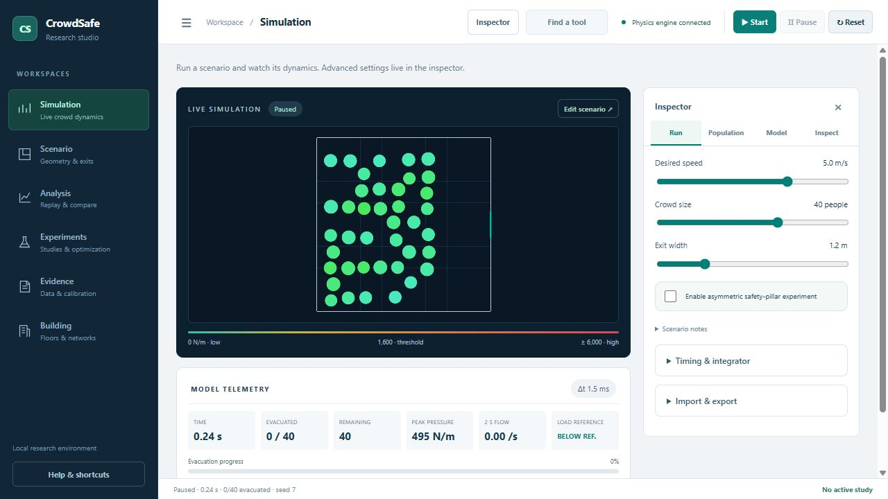
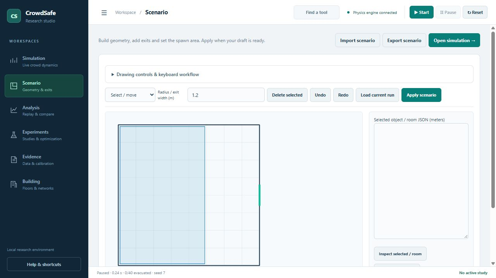
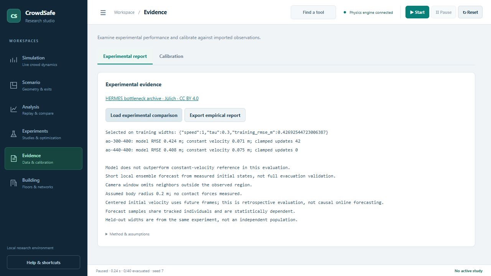

# CrowdSafe-Physics

**Design a scenario. Inspect the dynamics. Measure the outcome.**

A local research studio for pedestrian dynamics and evacuation experiments.
Build rooms, explore contact mechanics, replay trajectories and compare scenarios
using reproducible Python simulations.




## Explore the studio

| Workspace | Purpose |
| --- | --- |
| Simulation | Run the HFV engine and inspect flow, exits, loads and numerical diagnostics. |
| Scenario | Draw walls, pillars, exits and spawn areas; edit dimensions and apply a draft. |
| Analysis | Replay received frames, view spatial layers and capture A/B runs. |
| Experiments | Compare common-seed scenarios; run sweeps, sensitivity and design searches. |
| Evidence | Examine HERMES comparisons and calibrate against imported observations. |
| Building | Explore a separate network with capacities, stairs and visibility schedules. |

Use the collapsible sidebar, inspector tabs and tool finder (Ctrl+K) to navigate.
Product text and documentation are in English.

## Run locally

Requires **Python 3.10 or newer**. Run from the repository root.

### Windows PowerShell

```powershell
python -m venv .venv
.\.venv\Scripts\python.exe -m pip install -e .
.\.venv\Scripts\python.exe -m src.cli serve --port 8001
```

### Linux / macOS

```bash
python3 -m venv .venv
source .venv/bin/activate
python -m pip install -e .
python -m src.cli serve --port 8001
```

Open **http://127.0.0.1:8001/**. Keep the terminal running; stop with Ctrl+C.
The default port without `--port` is 8000. No JavaScript build, API key or database
is required. Installation includes `uvicorn[standard]` for WebSocket support.

## Your first experiment

1. In **Simulation**, adjust Desired speed and Crowd size, then press **Start**.
2. Press **Pause** to inspect the state. Run, Population and Model tabs contain settings.
3. In **Scenario**, edit a draft. Click twice for walls/spawn regions; the size field sets pillar radius or exit width. **Apply scenario** validates and resets.
4. Open **Analysis** for replay and spatial layers. Capture A before resetting for an A/B replay.
5. In **Experiments**, save settings as A and B, choose distinct seeds and run. Use the same observation horizon for both candidates.
6. Open **Results & archive** and export results. Completed studies persist in `outputs/studies`.



Navigation preserves drafts and the live run. Reloading/reconnecting starts a
new simulation: export scenarios and recordings first. The UI starts with 40
agents, a 1.2 m exit, a 0.0015 s timestep and a 120 s horizon.

## Scientific scope

This is an **exploratory research tool**. HFV provides social, elastic and frictional
forces, with two integrators and seeded population variation. Explicit exits and
interior walls enable clearance-aware grid routing. Groups and queue-based exit
choice are experimental heuristics; Building is a separate capacity model.

The HERMES local forecast evaluation performs worse than constant velocity and
uses centered initial velocities containing future frames. It is retrospective.
Full evacuation and contact loads lack independent empirical validation. The
1,600 N/m load reference is not a validated injury threshold.

Read [model limitations](docs/MODEL_STATUS.md) and [empirical findings](docs/EMPIRICAL_FINDINGS.md).



## CLI and verification

With the virtual environment active (or use its Python path on Windows):

```bash
python -m src.cli simulate --agents 40 --speed 2 --duration 60 --output outputs/example
python -m src.cli --help
python -m pytest -q
node --test tests/test_exit_editor.cjs
```

Node.js is needed only for editor tests. CI runs Python/editor tests, dependency
checks and a wheel build. Choose separate output folders to preserve experiments.

The [manuscript](PAPER.md), [benchmark summary](outputs/data/benchmark_summary.json)
and [figures](outputs/README.md) describe historical synthetic experiments before
current steering revisions. Rerun before comparing with current behavior:

```bash
python -m src.cli benchmark --agents 60 --dt 0.0015 --duration 90 --iterations 3 --population 4 --train-seeds 7 11 --seeds 19 23 31 --output outputs/new-benchmark
python -m src.cli plots --output outputs/new-benchmark
```

A full benchmark can take substantial time. `python -m src.empirical` regenerates
the HERMES comparison from the included attributed data. `python -m src.reporting`
regenerates BENCHMARK_REPORT.md, PAPER.md and the tutorial source index from the
archived default outputs, preserving this curated README.

## Documentation

Start at the [documentation index](docs/README.md).

- [User guide](docs/USAGE_GUIDE.md), [studio navigation](docs/STUDIO_GUIDE.md) and [scenario editor](docs/SCENARIO_EDITOR.md).
- [Analysis and calibration](docs/ANALYSIS_GUIDE.md), [research modules](docs/RESEARCH_MODULES.md).
- [Math and physics tutorial](MATH_AND_PHYSICS_TUTORIAL.md) and [archived manuscript](PAPER.md).
- [Contributing](CONTRIBUTING.md), [changelog](CHANGELOG.md) and [GitHub publishing](docs/PUBLISHING.md).

## License and attribution

Code and documentation: [MIT](LICENSE). HERMES data: **CC BY 4.0**, with separate
attribution in [third-party notices](THIRD_PARTY_NOTICES.md) and the
[dataset README](data/experimental/hermes/README.md). See [CITATION.cff](CITATION.cff).

Model reference: Helbing, Farkas & Vicsek (2000), *Simulating dynamical features
of escape panic*, Nature 407, 487–490, [doi:10.1038/35035023](https://doi.org/10.1038/35035023).
